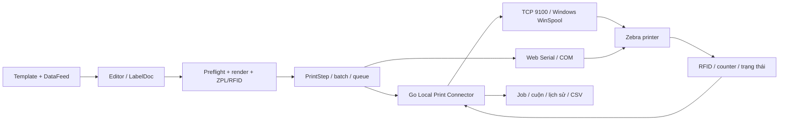

# Printer-controller · ZbrePrinter

Ứng dụng thiết kế template nhãn, biên dịch ZPL, in và đọc/ghi RFID cho máy in
Zebra. Phiên bản source hiện tại: **3.9.2**, Local Print Connector **0.12.2**.
Repo chứa đầy đủ **Electron + Next.js/React/TypeScript + connector Go** để
developer clone, review và build ứng dụng Windows.

## Nội dung project / kiến trúc code

```text
Printer-controller/
├─ electron/              # Khởi động app, Next server, connector, worker in ẩn
├─ web/
│  ├─ app/                # UI, model template, data feed, ZPL và điều phối in
│  │  ├─ components/     # Editor, thuộc tính, màn hình in và quản lý máy/cuộn
│  │  └─ api/            # Integration API và TCP phía Next server
│  ├─ native/local_print_agent_go/  # Connector: TCP, WinSpool, RFID, lưu job
│  ├─ template/          # Template mẫu .nwl
│  └─ scripts/           # Test logic web, ZPL, RFID và transport
├─ scripts/               # Build connector, stage web, kiểm tra bundle
├─ tests/                 # Test desktop runtime và chính sách đóng gói
├─ build/                 # Icon, script QA, fixture và release notes
└─ docs/                  # Tài liệu kỹ thuật và quy trình vận hành
```

| Phần cần review | File / module chính | Trách nhiệm |
| --- | --- | --- |
| Luồng UI | [page.tsx](web/app/page.tsx), [components/](web/app/components/) | Chọn template → Edit → Print; điều khiển nhiều máy. |
| Model và lưu template | [types.ts](web/app/types.ts), [reducer.ts](web/app/reducer.ts), [history.ts](web/app/history.ts), [storage.ts](web/app/storage.ts) | `LabelDoc`, cập nhật editor, undo/redo, import/export `.nwl`; template/session lưu trên máy. |
| Editor | [DesignerCanvas.tsx](web/app/components/DesignerCanvas.tsx), [ElementBox.tsx](web/app/components/ElementBox.tsx), [PropertiesPanel.tsx](web/app/components/PropertiesPanel.tsx) | Bố trí text, barcode, QR, Data Matrix, ảnh, bảng; kích thước, DPI và xoay template. |
| Dữ liệu → ZPL | [label-data.ts](web/app/label-data.ts), [data-feed.ts](web/app/data-feed.ts), [full-page-raster.ts](web/app/full-page-raster.ts), [zpl.ts](web/app/zpl.ts) | Ghép từng dòng dữ liệu/serial vào nhãn, raster hóa nội dung và sinh ZPL/RFID. |
| Điều phối in | [PrintStep.tsx](web/app/components/PrintStep.tsx), [print-batch.ts](web/app/print-batch.ts), [print-job-coordinator.ts](web/app/print-job-coordinator.ts), [fleet-spool.ts](web/app/fleet-spool.ts) | Preflight, chia chunk, xếp hàng theo máy; chuẩn bị và giao job cho connector. |
| Transport | [local-print-agent.ts](web/app/local-print-agent.ts), [tcp-print-job.ts](web/app/tcp-print-job.ts), [raw-spool-batch.ts](web/app/raw-spool-batch.ts), [webserial.ts](web/app/webserial.ts) | TCP 9100 qua connector, Windows RAW/USB qua WinSpool, hoặc COM/Web Serial. |
| Connector và RFID | [native/local_print_agent_go/](web/native/local_print_agent_go/), [PROTOCOL.md](web/native/local_print_agent_go/PROTOCOL.md) | `fleet_spool.go` giữ job; `tcp_job*.go` quản lý socket; `rfid_capture.go` thu EPC; `rfid_counter*.go` đối soát counter; `production_roll*.go` quản lý cuộn/CSV. |
| Desktop / tích hợp | [main.cjs](electron/main.cjs), [runtime.cjs](electron/runtime.cjs), [api/integration/](web/app/api/integration/), [PrintListenerClient.tsx](web/app/print-listener/PrintListenerClient.tsx) | Electron quản lý lifecycle; API nhận yêu cầu bên ngoài; worker ẩn xử lý hàng đợi browser-print. |



**Thứ tự đọc gợi ý:** `types.ts` → `page.tsx` → `PrintStep.tsx` → `zpl.ts`
→ `fleet_spool.go` / `tcp_job.go` → `rfid_capture.go` / `production_roll.go`.
Job đã gửi nhưng mất bằng chứng hoàn tất phải đối soát; việc TCP/WinSpool nhận
byte không chứng minh mọi nhãn hoặc EPC đã in/ghi thành công.

## Chạy và build

Yêu cầu: **Windows x64**, **Node.js ≥ 20.19**, **Go ≥ 1.22** trong `PATH`.
Chạy tại thư mục gốc repo:

```powershell
npm ci
npm ci --prefix web
npm test
npm run dist:win
```

`dist:win` build connector từ Go, build Next standalone trong `web/`, kiểm tra
bundle rồi tạo `dist/ZbrePrinter-App-Setup-3.9.2-x64.exe`. Không cần source từ
repo khác. `npm run prepare:desktop` rồi `npm start` để chạy Electron từ source;
`npm run dev --prefix web` để phát triển UI tại `http://localhost:8888`.
Desktop dùng Next tại `127.0.0.1:18888`, connector tại `127.0.0.1:17917`.

Kiểm tra các phần chính:

```powershell
npm run typecheck --prefix web
npm run test:zpl-rfid --prefix web
npm run test:print-batch-data --prefix web
npm run test:production-roll --prefix web
npm run test-agent:connector --prefix web
```

Các test Electron trong `build/*.cjs` cần `npm run pack:win` trước.
Lệnh test đầy đủ nằm trong [package.json](package.json) và
[web/package.json](web/package.json). Nếu cần dùng source web bên ngoài, đặt
`ZBREPRINTER_WEB_SOURCE`; mặc định luôn ưu tiên `web/` trong repo này.

## Bộ cài và quy tắc Git

- Bộ cài mới nhất phân phối qua [GitHub Releases](https://github.com/mickeykhuongtran/Printer-controller/releases/latest).
  Chỉ upload bộ cài **3.9.2 x64** trong lần bàn giao này; không đưa các bản cũ lên.
- `.gitignore` bỏ qua toàn bộ `dist/`, `bundle/`, `node_modules/`, `.next*`,
  binary connector được build, log, profile QA, snapshot và cấu hình bí mật.
- Giữ source, lockfile, template mẫu, test, icon và tài liệu. Binary connector
  cùng manifest được sinh lại bằng `npm run build:connector`.
- Bộ cài hiện có chưa ký Authenticode; dùng cho review/kiểm thử nội bộ.

Chi tiết: [desktop runtime](docs/DESKTOP.md),
[Windows RAW spool](docs/WINDOWS-SPOOL-BATCH.md),
[Integration API](web/docs/integration-api.md),
[quy trình counter/SOP](docs/COUNTER-SOP-REVIEW-2026-10-19.md).
