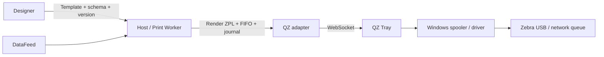

# Khả thi tích hợp QZ Tray với ZbrePrinter

Ngày đánh giá: 13/09/2026. Baseline: source `e1f9b37`, desktop `316537d`, app 3.1.0 / connector 0.5.0.

## Kết luận

Khả thi và đáng triển khai thử nghiệm. Hướng phù hợp là Designer chuyên thiết kế; host/Print Worker quản lý lệnh và dữ liệu; QZ Tray giao tiếp hệ điều hành; Windows spooler/driver truyền xuống Zebra. Cách này giảm phần native printing phải tự bảo trì, đồng thời giữ yêu cầu thứ tự và xử lý kết quả chưa rõ.

Đánh giá dựa trên tài liệu, mã nguồn QZ gắn tag v2.3.0 và code hiện tại. Chưa chạy benchmark/in phần cứng qua QZ. Chưa thay transport của app, cài thêm hay cập nhật QZ.

## Công cụ và phiên bản

`demo.qz.io` là trang mẫu API, không phải dịch vụ nhận template để tự vận hành toàn bộ quy trình. Tích hợp thực tế dùng `qz-tray.js` kết nối QZ Tray cài trên máy in qua WebSocket. [Getting Started](https://qz.io/docs/getting-started), [demo](https://demo.qz.io/).

GitHub công bố v2.3.0 ngày 11/09/2026, có thay runtime Java/JavaFX. Trên máy hiện tại có QZ Tray trong Program Files; thư viện demo đi kèm ghi 2.2.6. Đây chưa phải xác nhận phiên bản process đang chạy. Khi thử nghiệm cần pin cả JS lẫn runtime và đọc phiên bản qua API; kiểm tra 2.2.6 hiện có và 2.3.0 trước khi chọn bản triển khai. [Release 2.3.0](https://github.com/qzind/tray/releases/tag/v2.3.0).

## Phân chia trách nhiệm đề xuất

| Thành phần | Trách nhiệm |
| --- | --- |
| Designer | Bố cục, preview, kích thước/DPI, barcode/QR/DataMatrix, khai báo biến, template version và kiểm tra dữ liệu |
| Shared renderer | Chuyển template + giá trị từng dòng thành ZPL; giữ đúng HEX, font, ảnh và thông số RFID |
| Host/Print Worker | Nhận DataFeed, snapshot template/data, FIFO theo printer, lưu batch/payload/hash, chống nhận trùng, theo dõi và đối soát |
| QZ Tray | Tìm printer, gửi RAW ZPL vào queue Windows, nhận sự kiện printer/job |
| Windows/Zebra | Spool, driver/USB, thực thi ZPL, vận chuyển giấy và encode tag |

QZ nhận các định dạng in hoặc lệnh RAW, không cung cấp bộ diễn giải `.nwl` riêng của project. Vì vậy việc chuyển Designer thành ứng dụng chỉ thiết kế vẫn cần đưa renderer sang host/worker hoặc xuất payload hoàn chỉnh. Không được gửi thẳng `.nwl` cho QZ và kỳ vọng nó tự ánh xạ DataFeed. [API print](https://qz.io/api/qz).

## Windows RAW, HEX và Zebra

Dùng tên queue ZDesigner chính xác trong `qz.configs.create(...)`, để Windows giữ vai trò truyền qua USB. Không chọn trực tiếp `{host, port}` hoặc USB device API cho tuyến cần spooler. Hướng dẫn QZ ưu tiên driver hãng nếu nhận RAW tốt. [Windows RAW setup](https://qz.io/docs/setting-up-a-raw-printer-in-windows).

Giữ renderer ZPL hiện tại cho ZT610R/ZD621R. QZ không thay việc chọn đúng DPI, calibrate media/RFID hoặc kiểm tra tag. Mã HEX của người dùng nằm trong nội dung lệnh RFID; `flavor: 'hex'` của QZ lại chỉ định cách biểu diễn toàn bộ byte của lệnh gửi. Đề xuất dùng RAW command/base64 để bảo toàn payload đã render, không chuyển mã HEX thành ASCII và không làm mất số 0 đầu. [RAW printing](https://qz.io/docs/raw).

`forceRaw` là tùy chọn khác với `type: 'raw'`; tài liệu API hiện ghi forceRaw chưa hỗ trợ Windows. Tuyến đề xuất để `forceRaw: false`. [Config API](https://qz.io/api/qz.configs).

## Lô 1.000–2.500 tag và thứ tự

Ưu tiên thử một batch nghiệp vụ thành một Windows job. Case đã kiểm thử của app 3.1.0 là 2.500 tag, 250 chunk chuẩn bị, 1.440.300 byte RAW. Đây là số đo của fixture hiện tại, không phải kết quả benchmark QZ hay giới hạn cho mọi template.

Worker chuẩn bị đủ dữ liệu, kiểm tra số dòng/hash rồi gọi QZ một lần. Mỗi printer có một worker/lane; nhiều host cùng gửi phải dùng chung cơ chế admission. Các lời gọi print độc lập từ nhiều tab/client không được coi là có FIFO toàn cục.

Mã JS QZ nối tuần tự các phần tử khi truyền nhiều request trong cùng lời gọi; phía WebSocket lại xử lý message bằng thread riêng. Vì vậy vẫn cần quyền sở hữu printer queue ở tầng ứng dụng. [JS v2.3.0](https://github.com/qzind/tray/blob/v2.3.0/js/qz-tray.js), [WebSocket server](https://github.com/qzind/tray/blob/v2.3.0/src/qz/ws/PrintSocketClient.java).

QZ hỗ trợ `spool: { end: '^XZ', size: 100 }`. Với dữ liệu đơn giản có đúng một format/nhãn, 2.500 format thành khoảng 25 spool jobs. Đây là lựa chọn để benchmark, không phải cấu hình mặc định đề xuất. Cần xét `^PQ`, format lưu trong printer và lệnh cấu hình khi đếm; dấu kết thúc format không luôn tương đương một tag vật lý. [Advanced spooling](https://qz.io/docs/raw#advanced-print-spooling).

Đọc `PrintRaw.java` cho thấy QZ gom dữ liệu thành byte array, sau đó mới chia spool. Suy ra chia spool không thay thế streaming với bộ nhớ cố định. Những template raster lớn cần giới hạn theo byte và đo RAM, không chỉ đếm tag. [PrintRaw v2.3.0](https://github.com/qzind/tray/blob/v2.3.0/src/qz/printer/action/PrintRaw.java).

Giữ queue riêng, cùng priority, spooling bật, không pooling, không gửi song song qua đường TCP khác vào cùng máy. Cấu hình Start printing after last page is spooled tiếp tục là điều kiện thử nghiệm của hệ thống này. Không mặc định QZ sẽ phát hiện hoặc sửa các thiết lập đó.

## Kết quả, lỗi và phục hồi

Tài liệu nói rõ promise `qz.print()` hoàn tất không xác nhận in vật lý xong. API trả promise null/error, không trả receipt batch/job ID tương đương connector 0.5.0. Không thể thay duy nhất hàm send rồi giữ nguyên cách hiểu trạng thái cũ. [Print API](https://qz.io/api/qz).

Có thể nghe trạng thái bằng `startListening`, `setPrinterCallbacks`, `getStatus`; các trạng thái được ánh xạ từ Winspool/CUPS. Dùng jobName chứa UUID để liên hệ sự kiện với batch; kiểm tra job ID thực tế khi có. Sự kiện có thể bỏ lỡ lúc mất kết nối; không coi job biến mất là đã đủ tag. [Printer status](https://qz.io/docs/printer-status).

Trong đường RAW được đọc, các callback failed/cancelled/no-more-events đều có thể kết thúc vòng đợi. Do đó worker phải xem sự kiện lỗi riêng, không dùng chỉ promise resolve làm tín hiệu thành công cuối cùng. Đây là nhận xét từ source, cần tái hiện trên driver đích. [PrintRaw v2.3.0](https://github.com/qzind/tray/blob/v2.3.0/src/qz/printer/action/PrintRaw.java).

Không thấy API công khai tương đương durable begin/append/commit có checkpoint và idempotency xuyên restart. Request UID của WebSocket dùng đối chiếu response; không dùng thay batch ID nghiệp vụ. Tầng xử lý request trả kết quả sau parse/print, chưa đủ cơ sở để bỏ journal hiện tại. [PrintingUtilities v2.3.0](https://github.com/qzind/tray/blob/v2.3.0/src/qz/utils/PrintingUtilities.java).

Journal đề xuất giữ: batchId, templateVersion, printerName, range/count, payloadHash, đường dẫn payload, thời điểm submit, jobName, jobId nếu biết, trạng thái submitted/failed/uncertain và quyết định operator. Lưu submitting trước gọi QZ; mất kết nối trong lúc gửi chuyển uncertain, giữ lane và không tự gửi lại. Đây là nghiệp vụ host, có thể tách khỏi Designer và không cần tự viết WinSpool.

## Dễ dùng, ký lệnh và triển khai

Trải nghiệm mục tiêu: cài QZ một lần, chọn máy in một lần, sau đó người vận hành chọn template/data rồi bấm in. Chỉ hiện trạng thái kết nối, số dòng và lỗi cần hành động; giấu các lựa chọn RAW/USB/socket nâng cao khỏi luồng thường dùng.

Silent printing cần ký message và trust certificate. QZ ưu tiên ký ở backend; offline signing phía client có thể làm lộ private key. Đề xuất endpoint ký có xác thực, kiểm tra quyền printer/job/payload; không đặt private key chung trong renderer/JS. Nếu cần offline hoàn toàn, signer phải sẵn ở host/LAN hoặc được provision riêng tại máy. [Signing](https://qz.io/docs/signing).

QZ miễn phí với cơ chế cảnh báo; có thể dùng certificate QZ hoặc tự quản lý root certificate theo tài liệu. Premium Support đang niêm yết $749 cho gói một năm tại thời điểm đọc; phạm vi sử dụng/gia hạn cần xác nhận trước mua. API/demo và phần mềm có điều khoản khác nhau, cần theo tài liệu khi phân phối. [FAQ](https://qz.io/docs/faq), [Premium](https://buy.qz.io/Premium-Support-_p_13.html), [Licensing](https://qz.io/docs/licensing).

Host ở PC khác cần thiết kế TLS, chứng chỉ và quyền truy cập phù hợp, không chỉ thay localhost bằng IP. Hướng dẫn Windows Service của QZ dùng NSSM và ghi rõ không được hỗ trợ chính thức. Vì vậy không coi hoạt động khi logoff như Tray app thông thường; phải nghiệm thu user/session/service riêng. [Print server](https://qz.io/docs/print-server), [Windows service](https://qz.io/docs/windows-service).

## Phạm vi thay đổi project

| Vị trí hiện tại | Hướng xử lý |
| --- | --- |
| `app/zpl.ts`, `rfid.ts`, `dpi-preflight.ts`, renderer | Giữ; tách package chia sẻ cho Designer và worker |
| `app/components/PrintStep.tsx` | POC thêm QZ adapter; bản Designer cuối chỉ giữ in thử nếu cần |
| `app/print-listener/PrintListenerClient.tsx` | Chuyển phần nhận job/render sang worker độc lập Designer |
| `app/server-raw-print.ts` và integration routes | Thay contract RAW connector bằng job service + QZ adapter; giữ API nghiệp vụ |
| `app/raw-spool-batch.ts`, pending/history UI | Tách journal khỏi transport; không giả lập receipt QZ như receipt Go |
| `native/local_print_agent_go` | Có thể bỏ khỏi bản QZ sau khi nghiệm thu toàn bộ chức năng đang dùng |
| `electron/main.cjs`, `runtime.cjs`, scripts build/verify | Bỏ bắt buộc connector 0.5; thêm QZ discovery/version/trust; điều chỉnh quit guard và quyền mạng tối thiểu |

Không fallback tự động QZ sang connector cũ sau timeout: cả hai có thể đã nhận cùng lệnh. Nếu giữ hai transport trong giai đoạn chuyển đổi, chỉ một transport sở hữu mỗi batch/printer.

## Độ khó và lộ trình

| Công việc | Đánh giá |
| --- | --- |
| Gửi một template ZPL qua queue Windows bằng QZ | Dễ, vì đã có renderer và payload |
| Thay connector trong app nhưng giữ UX/trạng thái đúng | Trung bình |
| Tách Designer và Print Worker, giữ durable FIFO/recovery | Trung bình đến cao |
| Host từ xa, offline signing, chạy không đăng nhập | Cần triển khai và nghiệm thu riêng |

1. POC một tuyến QZ → Windows queue, giữ renderer, đối chiếu payload với bản 3.1.0.
2. Thử 1/10/1.000/2.500 tag; đo thời gian chuẩn bị, spool, RAM và số job. So sánh một job với chia spool khi có dữ liệu cho thấy cần.
3. Thử pause/hết giấy/rút USB, tắt QZ, mất WebSocket, đóng Designer, restart host; xác nhận không tự in trùng hoặc bỏ batch.
4. Kiểm thử nhiều client, quyền signer, chứng chỉ hết hạn, cold start và update QZ. Chuẩn bị installer và một màn hình thiết lập ngắn.
5. Nghiệm thu đủ số lượng/thứ tự và mã trên ZT610R/ZD621R thực tế rồi mới gỡ connector Go khỏi bản vận hành.

Lợi ích kỳ vọng lớn nhất là giảm chi phí bảo trì lớp native/driver integration. Hiệu suất in và mức dùng RAM phải đo trên template, firmware, driver và media thực tế; nghiên cứu này chưa chứng minh QZ nhanh hơn bản hiện tại.
